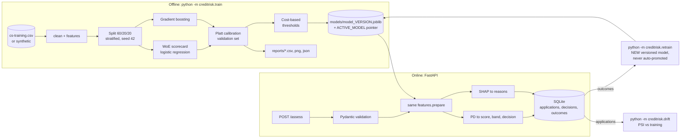

# CreditRisk: explainable credit risk scoring for a bank

A small but realistic credit-risk system: given a loan applicant it returns a **probability of default (PD)**,
a **credit score**, a **risk band**, an **APPROVE / REFER / DECLINE decision**, and **plain-English reasons**.
It includes a traditional WoE scorecard baseline, a gradient boosting model, SHAP explanations, drift monitoring,
a feedback loop with safe retraining, a FastAPI service and SQLite storage.

> **Data used for every number in this repo: SYNTHETIC.**
> The Kaggle file `cs-training.csv` was *not* available in the build environment (and the project never downloads it
> or authenticates to Kaggle). All results below come from a generated dataset with the same columns, so they are
> **not comparable to published Kaggle results and say nothing about real bank performance.**
> To use real data, put `cs-training.csv` in `data/` and re-run training; the loader detects it automatically.
> Real Kaggle data has not been tested with this code (only a format-compatible fake file in a unit test).

## Business problem
For each loan application: (1) estimate PD (serious delinquency within 2 years), (2) convert it to a score
(600 points at 50:1 good:bad odds, +20 points doubles the odds), (3) decide APPROVE / REFER / DECLINE,
(4) give adverse-action style reasons, (5) give a calibrated PD and a Low/Medium/High risk band.

## Architecture


## Quick start (Windows PowerShell)
```powershell
cd credit-risk-system
python -m venv .venv                      # project-local environment (nothing installed globally)
.\.venv\Scripts\Activate.ps1
pip install -e ".[dev]"

pytest                                    # 48 tests, ~12 s
python -m creditrisk.train                # trains both models, writes models/ and reports/
python -m creditrisk.demo                 # scores a strong, a borderline and a weak applicant
python -m uvicorn creditrisk.api:app      # API on http://127.0.0.1:8000  (docs at /docs)
```
Optional: download `cs-training.csv` yourself from Kaggle ("Give Me Some Credit") into `data/`, then re-run
training. If an `ACTIVE_MODEL` already exists, delete `models\*` first (or promote the new version, see below).

Other commands:
```powershell
python -m creditrisk.retrain                      # merge recorded outcomes + training data -> NEW model file
python -m creditrisk.retrain --promote <version>  # manual switch of the active model
python -m creditrisk.drift                        # PSI of stored applications vs the active model's training data
```
Configuration (paths, seed, costs, thresholds, score scale, caps) lives in `config.yaml`;
set `CREDITRISK_CONFIG` to use another file.

## API examples
```powershell
$body = '{"application_id":"APP-001","revolving_utilization":0.40,"age":38,"past_due_30_59":0,"debt_ratio":0.35,"monthly_income":4500,"open_credit_lines":7,"past_due_90":0,"real_estate_loans":1,"past_due_60_89":0,"dependents":2}'
Invoke-RestMethod -Method Post -Uri http://127.0.0.1:8000/assess -ContentType "application/json" -Body $body
Invoke-RestMethod http://127.0.0.1:8000/referral-queue
Invoke-RestMethod -Method Post -Uri http://127.0.0.1:8000/applications/APP-001/outcome -ContentType "application/json" -Body '{"defaulted":false}'
Invoke-RestMethod http://127.0.0.1:8000/applications/APP-001
```
Real output from the build run (model trained on synthetic data):
```json
{"application_id":"APP-001","probability_of_default":0.067348,"credit_score":563,"risk_band":"Medium",
 "decision":"REFER","reasons":["Revolving credit utilization is moderate (40%)","Monthly income is moderate ($4,500)"],
 "model_version":"20261101-100143"}
```
(Produced by calling the scorer directly with this payload; the HTTP layer was smoke-tested separately with curl.)
Full reference: [docs/api.md](docs/api.md).

## Results (SYNTHETIC data, 60,000 rows, 7.03% default rate, test set = 12,000 rows)
Both models are scored on the identical held-out test set; PDs are Platt-calibrated on the validation set.

| Metric | Scorecard (WoE + LR) | Gradient boosting |
|---|---|---|
| ROC-AUC | 0.7691 | 0.7680 |
| Gini | 0.5382 | 0.5360 |
| KS | 0.4148 | 0.4087 |
| PR-AUC | 0.2415 | 0.2524 |
| Brier | 0.0593 | 0.0590 |

Decisions with the gradient boosting model (cut-offs derived from costs: APPROVE if PD < 0.0388, DECLINE if PD >= 0.0971):
approve 45.5%, refer 33.8%, decline 20.7%; default rate among approved 2.3% vs 18.8% among declined.

**How to read this honestly:** the two models are statistically indistinguishable here. That is expected because the
synthetic defaults were generated from a near-linear logistic rule, which a scorecard captures fully. On real data,
boosting usually gains a little over a scorecard; I have *not* verified that in this repo. The point of the
scorecard is transparency and regulatory familiarity, not accuracy. Details and fairness numbers: [docs/model_card.md](docs/model_card.md).

## Project structure
```
config.yaml            all paths, seed, costs, thresholds, score scale, cleaning caps
src/creditrisk/
  config.py   data.py  features.py  scorecard.py  train.py  evaluate.py
  explain.py  scoring.py  store.py  api.py  drift.py  retrain.py  demo.py
tests/                 48 pytest tests (fast, isolated, tmp paths)
docs/                  PRD, architecture, data dictionary, model card, API, interview guide, next projects
data/ models/ reports/ inputs, versioned model files, generated reports (git-ignored)
Dockerfile             NOT TESTED (Docker not installed on the build machine)
```

## Design decisions
- **One feature function for training and serving** (`features.prepare`), with a parity test: no train/serve skew.
- **Imputation statistics are learned on the training split only**; calibration and thresholds on validation; the test set is touched once.
- **Imbalance:** stratified splits, balanced sample weights for boosting, Platt calibration to restore true PDs,
  and metrics that are meaningful at 7% prevalence (never accuracy).
- **Age is not a model input** (lending regulations such as ECOA/Reg B in the US restrict its use in credit decisions;
  the exact rules depend on jurisdiction). Age is accepted by the API only to monitor fairness and is stored, never scored.
- **Thresholds from cost**: decline when the expected loss of approving exceeds the expected profit lost by declining
  (`PD > P/(C+P)` for a calibrated model); the exact cut-off is chosen empirically on the validation set.
- **Reasons only from risk-increasing SHAP features** for REFER/DECLINE; favourable factors for APPROVE.
- **Retraining never replaces the active model**; promotion is a separate explicit command.
- Application + decision are written in **one SQLite transaction**.

## Limitations
- Synthetic data; real-data behaviour untested. Gradient boosting will have to prove itself on real data.
- Scorecard bins are quantile-based and monotonicity is **not** enforced; with correlated engineered features
  (e.g. `TotalPastDue` and its components) some points can be counter-intuitive (see `IncomePerDependent` in the demo).
- The model is only calibrated on the data distribution it saw; selection bias (we only observe outcomes for approved loans) is ignored.
- The API has **no authentication**, no rate limiting, and stores applicant data unencrypted in SQLite: fine for a demo, not for production.
- Model files are `joblib` pickles: only load files this project produced.
- REFER items leave the referral queue only when an outcome is recorded; there is no separate reviewer workflow.
- Credit scores in the API come from the gradient boosting PD; the scorecard breakdown is shown in the demo/reports only.
- Retraining merges feedback into the training split only and compares on the original test split; with few feedback rows, differences are noise.
- Not tested: Docker image, real Kaggle data, concurrency under load.

## Tested environment
Windows 11, Python 3.12.10; numpy 2.5.4, pandas 3.1.0, scikit-learn 1.9.1, shap 0.54.1, fastapi 0.162.0, pydantic 2.14.2, pytest 9.2.0.
Lower bounds are in `pyproject.toml`; other versions were not tried.
